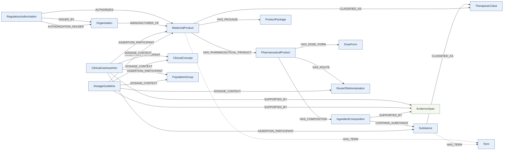
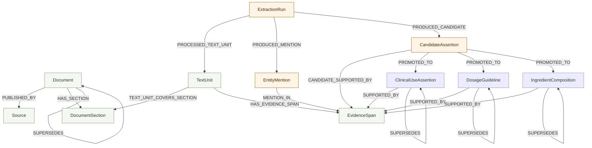
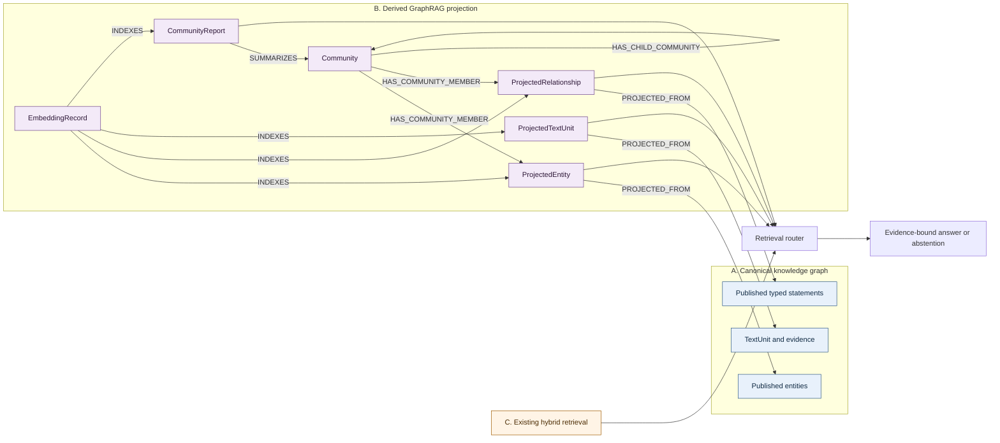

# Pharmeazor Knowledge Graph Ontology

**Version:** 0.1 
**Status:** Draft — design only; not approved for implementation 
**Date:** 2026-11-27 
**Companion documents:** [GRAPH_SCHEMA.md](./GRAPH_SCHEMA.md), [RETRIEVAL.md](./RETRIEVAL.md), [RAG_CHUNKER_PHASE1.md](./RAG_CHUNKER_PHASE1.md)

This document defines **what** the canonical pharmaceutical knowledge graph is
intended to represent. It does not define a database, an extractor, a GraphRAG
engine, or a clinical decision-support system.

The graph is not a source of truth about a medicine. The source documents and
structured source records remain the evidence of record. A graph assertion is
only as trustworthy as its traceable evidence and its reviewed publication
status.

## 1. Governance

### 1.1 Purpose

Define a minimal, evidence-bearing ontology that can:

- identify products, substances, compositions, forms, packages, organizations,
  and regulatory authorizations without inventing identity;
- represent clinical statements without losing population, route, dose,
  frequency, duration, negation, uncertainty, jurisdiction, or wording;
- preserve exact evidence and document provenance;
- preserve revisions and conflicting source statements without silently choosing
  one;
- provide a stable contract for a later GraphRAG projection while keeping the
  existing hybrid retrieval system as the baseline and fallback.

### 1.2 Status of this version

This is a **proposed v0.1**. No canonical graph, extraction pipeline,
entity-resolution process, GraphRAG projection, graph database, or clinical
publication workflow exists in the repository. The current repository policy
explicitly prohibits adding a knowledge-graph or graph-retrieval system without
owner approval (`AGENTS.md:100-106`). This document records a design proposal; it
does not override that policy.

No part of this document has been medically validated. It is ready for
multidisciplinary review, not for clinical use.

### 1.3 Scope

In scope for v0.1:

- knowledge represented in the cleaned EN/FR corpus observed on 2026-11-27;
- 40 internal target-medicine groups (`MED001`–`MED040`) and their source
  documents;
- SmPC/RCP, patient notice, DailyMed label, and Algerian nomenclature document
  types;
- structured BDPM and Ministry of Health reference extracts where present;
- clinical assertions, dosage statements, composition, product structure,
  evidence, revisions, and terminology aliases;
- a technology-neutral logical GraphRAG projection contract.

Out of scope:

- patient records, patient-specific advice, diagnosis, prescribing, treatment
  selection, or automatic clinical recommendations;
- proof of regulatory approval or compliance;
- a graph database, index, prompt, extraction run, entity-resolution algorithm,
  or GraphRAG implementation;
- changes to the existing PostgreSQL retrieval schema, chunk IDs, metadata,
  embeddings, ingestion, benchmark data, or hybrid retriever;
- unverified cross-jurisdiction equivalence of products, brands, or substances;
- an Arabic source corpus, which is absent from the observed snapshot;
- global claims about the whole corpus that are not backed by reviewed evidence.

### 1.4 Assumptions

1. Source documents are public regulatory, label, or register material. No
   patient data should enter the corpus.
2. A source statement is evidence of what that source says, not evidence that the
   statement is universally true, current, or applicable to every patient.
3. `MED001`–`MED040` are internal target-medicine grouping/scoping identifiers,
   not canonical medicinal-product identifiers.
4. Existing chunk IDs are technical retrieval identifiers. They are not
   canonical knowledge identifiers.
5. Contextualization notes and community reports are generated helpers. They are
   not source evidence.
6. Missing dates, strengths, routes, populations, identifiers, or authorization
   statuses remain unknown. They are never filled by inference.
7. The existing hybrid retriever is the current production baseline and remains
   the fallback until a graph-based approach is separately evaluated.
8. Authority precedence is an application policy, not an ontological truth. The
   source registry currently contains an unresolved authority-level
   inconsistency; see §2.4.

### 1.5 Required reviewers

| Role                                           | Responsibility                                                                                   | Status                                  |
| ---------------------------------------------- | ------------------------------------------------------------------------------------------------ | --------------------------------------- |
| Project owner                                  | Approve ontology direction and implementation gate                                               | Required; approval not recorded here    |
| Licensed pharmacist / clinical domain reviewer | Review clinical assertion semantics, qualifier completeness, source-boundary rules, and examples | Required; not assigned in this document |
| Data steward                                   | Review identity rules, source mappings, term normalization, and revision policy                  | Required; not assigned                  |
| Retrieval/data engineer                        | Review evidence links, projection rules, loss analysis, and evaluation implications              | Required                                |
| Security/privacy reviewer                      | Confirm no patient data and define authorization propagation                                     | Required before any implementation      |

### 1.6 Review and change rules

- v0.1 is a draft until the required reviewers sign off.
- Clinical semantics, identity rules, or provenance constraints cannot be changed
  by an extraction model or a prompt.
- Any later addition of a clinical entity, relationship, or inference rule
  requires a versioned ontology change and domain review.
- A model-written description, confidence score, embedding similarity, or
  community summary cannot promote a candidate to a published assertion.
- The source documents remain the evidence of record after publication. A graph
  record must not overwrite or replace them.
- A future implementation must not silently weaken the existing project's
  authorization, citation, abstention, or ingestion safeguards
  (`AGENTS.md:44-78,242-253`).

### 1.7 Status legend

Status codes are intentionally conservative:

- **V — corpus/repository-supported basis:** source evidence or repository
  evidence for the underlying fields exists in the inspected corpus/repository.
  This does not mean the proposed graph concept is already populated or
  clinically validated.
- **P — proposed / use-case-derived:** the logical concept or field is a design
  abstraction required by the stated use cases. No production graph
  implementation exists.
- **R — awaiting domain/data review:** identity, terminology, qualifier, or
  clinical semantics need review by a pharmacist, data steward, or security
  reviewer before use.
- **N — not implemented:** no production implementation exists at all.

Most entities below are `P` because the graph itself is not implemented. `V`
refers to the evidence basis, never to clinical truth.

## 2. Evidence basis and corpus reality

### 2.1 Repository and policy facts

- The current production retrieval pipeline is the existing hybrid pipeline:
  dense retrieval, BM25, RRF with `k=60`, optional reranking, then composition
  (`AGENTS.md:34-78`; `docs/RETRIEVAL.md`).
- Graph retrieval is not implemented and is currently prohibited without owner
  approval (`AGENTS.md:100-106`; `docs/RAG_BASELINE.md`).
- The current production chunker is character-window based and has documented
  limitations: possible lost/mid-sentence overlap, cross-section packing,
  aggregate section metadata, and no table/list structural protection
  (`docs/RAG_CHUNKER_PHASE1.md`).
- Existing chunk metadata contains section headings/paths and aggregate section
  codes, but not explicit parent IDs, child membership, or source spans.
  Artifact reconstruction further drops section paths and multi-section
  membership (`docs/RAG_CHUNKER_PHASE1.md`; `packages/api/src/workers/retrieval/artifact-documents.ts`).
- The current retrieval fields include `content` and `contextualizedContent`;
  only raw `content` is suitable as a future evidence surface. The note is
  generated context, not evidence (`docs/RAG_CHUNKER_PHASE1.md`;
  `packages/api/src/workers/retrieval/contextualize.ts`).
- The benchmark has 50 approved/verified questions and no explicit multi-hop,
  hop-path, or required-edge labels. Ten questions have multiple relevant
  chunks; that is not the same as a multi-hop label (`docs/RAG_CHUNKER_PHASE1.md`;
  `packages/benchmark/data/v1/dataset.meta.json`).

### 2.2 Observed corpus snapshot

The cleaning output is generated and ignored by Git, so these counts are a
read-only observation of the local generated snapshot, not a committed corpus
version. The observed date is 2026-11-27. The manifest SHA-256 is
`75fa89e35e6511243216d85ed7ff6013aa0846ec7270c4568ba898e2648fe9ff`.

| Observation                                                                     | Value                                                              |
| ------------------------------------------------------------------------------- | ------------------------------------------------------------------ |
| Manifest rows                                                                   | 624                                                                |
| Document artifacts                                                              | 621                                                                |
| Clean document artifacts                                                        | 558                                                                |
| Duplicate document artifacts                                                    | 63                                                                 |
| Structured reference artifacts                                                  | 3                                                                  |
| Clean documents by source                                                       | `ANPP_RCP` 40, `BDPM_FR` 310, `DAILYMED` 168, `SANTE_MSP` 40       |
| Clean document types                                                            | `smpc` 350, `label` 168, `nomenclature` 40                         |
| Clean parts                                                                     | `smpc` 40, `rcp` 157, `notice` 153, `label` 168, `nomenclature` 40 |
| Clean languages                                                                 | French 390, English 168, Arabic 0                                  |
| Unique target medicine IDs                                                      | 40                                                                 |
| Clean documents covering multiple medicine IDs                                  | 8                                                                  |
| Clean-document section headings in manifest metadata                            | 21,608                                                             |
| Clean-document headings mapped to `other`                                       | 9,182                                                              |
| Clean docs with `indications` / `dosage` / `contraindications` / `interactions` | 493 / 440 / 477 / 476                                              |
| Clean docs with `warnings` / `pregnancy` / `adverse_effects` / `overdose`       | 509 / 426 / 487 / 323                                              |
| Publication date present                                                        | 518 of 558; 40 missing                                             |
| Revision date present                                                           | 157 of 558; 401 missing                                            |
| Non-empty `brand_name`                                                          | 16 of 558                                                          |
| Non-empty `strength_form`                                                       | 0 of 558                                                           |
| Non-empty `holder`                                                              | 40 of 558                                                          |

The old checked-in documentation contains different historical snapshots. For
example, the cleaning README describes 528 clean documents and an older
retrieval baseline describes a different corpus. Those numbers must not replace
the observed snapshot above, and the ontology must use document-level hashes for
associations rather than a global count.

No clean documents from `ANPP_SITE`, `EMA`, `PHARMNET`, or
`PHARMNET_CATALOG` were present in this clean snapshot. The structured source
references were BDPM CIS, BDPM composition, and the Ministry nomenclature;
Pharm'Net register chunks that appear in historical retrieval traces must not be
treated as current corpus evidence.

Structured reference rows observed:

- BDPM CIS register: 1,399 rows.
- BDPM composition register: 3,614 rows.
- Ministry of Health nomenclature products: 9,595 rows.

These are source records, not automatically validated canonical entities.

### 2.3 What the corpus can and cannot support

Corpus-supported surface material includes:

- brand/product strings, INN/DCI strings, strengths, forms, packs, registration
  numbers, dates, holders, section headings, and free-text clinical sections;
- English DailyMed labels and French RCP/notice/nomenclature documents;
- exact source wording and source URLs.

Not supported by the observed corpus/metadata:

- Arabic source documents or Arabic source terminology;
- complete normalized route fields for every product;
- populated `strength_form` in the clean manifest (the field exists but is
  empty in the observed snapshot);
- canonical product equivalence across BDPM, DailyMed, ANPP, and Ministry
  registers;
- reviewed clinical assertions, dosage structures, population structures, or
  entity resolutions;
- explicit document-revision edges or multi-hop benchmark labels;
- RxNorm, UNII, SNOMED CT, ICD, MedDRA, or UCUM identifiers (none were observed in
  the inspected metadata);
- proof of regulatory approval or legal compliance.

### 2.4 Authority metadata conflict

There is a verified inconsistency in source metadata that must be resolved by
governance before any authority rank is treated as a canonical fact:

- `tooling/retrieval-lab/data/metadata/sources.csv` records `SANTE_MSP` at
  authority level 2 and `PHARMNET_CATALOG` at level 4.
- `tooling/cleaning-lab/config.yaml` comments describe the Ministry nomenclature
  as level 1 and the Pharm'Net catalogue as level 2.
- `docs/RETRIEVAL.md` describes the official Algerian sources at level 1.
- The observed clean manifest records `SANTE_MSP` documents at authority level 2.
- `packages/services/src/retrieval/authority.ts:22-35` defines level 1 as ANPP
  plus the Ministry of Health and level 2 as the non-official Pharm'Net register;
  `AUTHORITY_PRECEDENCE` repeats this at `authority.ts:80-87`.

This is not only a documentary mismatch. The production retrieval rows inherit
the manifest's level 2 for `SANTE_MSP`, while `authorityDescriptor(2)` describes
level 2 as the non-official Pharm'Net register. An official Ministry document can
therefore be labelled or ranked with the wrong descriptor until the registry,
manifest, and service policy are reconciled. The ontology records source
authority as **metadata with provenance**, not as an ontological fact, and does
not choose a winner silently. This must be resolved before authority-dependent
graph or retrieval implementation.

This concrete runtime risk was identified in the independent review; it is a
pre-existing application-policy issue, not a Phase 2 code change.

## 3. Layer boundaries

| Layer                            | What it contains                                                                         | Source of truth                                   | Current status                                                |
| -------------------------------- | ---------------------------------------------------------------------------------------- | ------------------------------------------------- | ------------------------------------------------------------- |
| **Evidence**                     | Source registry, documents, sections, existing text units, proposed exact evidence spans | Clean Markdown, manifest, structured source files | Documents/sections/text units exist; exact spans are proposed |
| **Candidate observation**        | Mentions and candidate statements produced by an extractor                               | Extraction output, never published automatically  | Not implemented                                               |
| **A. Canonical knowledge graph** | Reviewed entities, structural facts, and typed clinical statements with provenance       | Evidence plus reviewed validation                 | Proposed only                                                 |
| **B. GraphRAG projection**       | Derived entities, relationships, text units, communities, reports, and embeddings        | Published canonical graph and text units          | Proposed; no GraphRAG implementation                          |
| **C. Existing hybrid retrieval** | Dense + BM25 + RRF + optional reranker                                                   | Current PostgreSQL retrieval index                | Implemented; baseline/fallback                                |

Rules:

1. Candidate mentions and candidate assertions may be stored for evaluation, but
   are never served as canonical knowledge.
2. Only a published canonical assertion can be an answer-bearing clinical claim.
3. GraphRAG projection consumes published canonical records only.
4. Community reports and generated entity descriptions are retrieval aids, not
   primary evidence.
5. The existing hybrid retriever remains the baseline and fallback. GraphRAG must
   not be assumed to improve retrieval until a separate evaluation says so.

### 3.1 Canonical graph and projection are not the same graph

The canonical graph is a reviewable knowledge model. The projection is a lossy
retrieval representation. A projection may merge descriptions, flatten a
relationship, or summarize a community. None of those transformations may flow
back into the canonical graph.

## 4. Competency questions

These questions define the minimum knowledge contract. “Benchmark-aligned”
means the question shape is represented in the existing approved benchmark; it
does not mean the graph currently answers it. “Proposed” means it is a design
requirement not represented by a current benchmark label.

| ID    | Competency question                                                                                                                                           | Type      | Expected entities and relationships                                                                                                                                                                | Required evidence                                                                                   | Status                                                                                                                                                                                              |
| ----- | ------------------------------------------------------------------------------------------------------------------------------------------------------------- | --------- | -------------------------------------------------------------------------------------------------------------------------------------------------------------------------------------------------- | --------------------------------------------------------------------------------------------------- | --------------------------------------------------------------------------------------------------------------------------------------------------------------------------------------------------- |
| CQ-01 | Given a source name, brand, strength, and form, which medicinal and pharmaceutical product is being referred to, and which active substances does it contain? | Local     | `MedicinalProduct`, `PharmaceuticalProduct`, `IngredientComposition`, `Substance`, `Term`; `HAS_TERM`, `HAS_PHARMACEUTICAL_PRODUCT`, `HAS_COMPOSITION`, `CONTAINS_SUBSTANCE`                       | Document/section text or structured composition/register record; exact source label and identifiers | Benchmark-aligned in shape (`Q-MID-001`, `Q-MID-003`, `Q-MID-004`, `Q-MID-006`); canonical identity proposed                                                                                        |
| CQ-02 | Which dose forms, routes, strengths, and packages are stated for a product?                                                                                   | Local     | `PharmaceuticalProduct`, `DoseForm`, `RouteOfAdministration`, `ProductPackage`, `IngredientComposition`; `HAS_DOSE_FORM`, `HAS_ROUTE`, `HAS_PACKAGE`                                               | `dosage_forms`, `composition`, `package` sections; structured form/pack fields                      | Proposed; some form and pack strings are corpus-supported                                                                                                                                           |
| CQ-03 | Which indication and dosage guidance does the source state, including population, route, frequency, duration, and maximum?                                    | Local     | `ClinicalUseAssertion`, `DosageGuideline`, `ClinicalConcept`, `PopulationGroup`, `RouteOfAdministration`; `ASSERTION_PARTICIPANT`, `DOSAGE_CONTEXT`, `SUPPORTED_BY`                                | `indications`, `dosage`, and applicable population text; exact wording                              | Benchmark-aligned in shape (`Q-DNK-*`); structured dosage graph proposed                                                                                                                            |
| CQ-04 | Which contraindications, precautions, warnings, and adverse effects are stated, and under which conditions or populations?                                    | Local     | `ClinicalUseAssertion` with `assertionKind` values; `ClinicalConcept`, `PopulationGroup`, `Substance`; `ASSERTION_PARTICIPANT`, `SUPPORTED_BY`                                                     | `contraindications`, `warnings`, `pregnancy`, `adverse_effects`, or label equivalents               | Benchmark-aligned in shape (`Q-CAW-*`, `Q-DRI-*`); assertion graph proposed                                                                                                                         |
| CQ-05 | Which interactions are stated, with which interactants, effects, and source-stated management?                                                                | Local     | `ClinicalUseAssertion` (`interaction`), `Substance`, `MedicinalProduct`, `ClinicalConcept`; `ASSERTION_PARTICIPANT`, `SUPPORTED_BY`                                                                | `interactions` section or label equivalent; exact interactant wording                               | Benchmark-aligned in shape (`Q-DRI-*`); n-ary interaction model proposed                                                                                                                            |
| CQ-06 | What does a source state for pregnancy, lactation, pediatric, geriatric, renal, hepatic, or other populations?                                                | Local     | `PopulationGroup`, `ClinicalUseAssertion`, `DosageGuideline`; `ASSERTION_PARTICIPANT`, `DOSAGE_CONTEXT`                                                                                            | Population-specific source wording; no default population                                           | Partly benchmark-aligned (`Q-CAW-003`, `Q-CAW-007`); structured population model proposed                                                                                                           |
| CQ-07 | Which source, document, section, text unit, and exact span support a statement, and what were its publication, revision, collection, and extraction dates?    | Local     | `Source`, `Document`, `DocumentSection`, `TextUnit`, `EvidenceSpan`, `ExtractionRun`; `PUBLISHED_BY`, `HAS_SECTION`, `TEXT_UNIT_COVERS_SECTION`, `HAS_EVIDENCE_SPAN`, `MENTION_IN`, `SUPPORTED_BY` | Exact raw text quote, offsets, source URL, document hash, date fields                               | Benchmark-aligned in shape only (`Q-TOS-004`, `Q-TOS-007`, `Q-TOS-009`). Their committed evidence is from the older Pharm'Net trace/artifact, not the observed clean manifest; exact spans proposed |
| CQ-08 | What changed between source revisions, and how are conflicting source statements presented without silent resolution?                                         | Multi-hop | `Document`, `SUPERSEDES`, assertions, `RegulatoryAuthorization`; source dates and authority provenance                                                                                             | Revision/publication dates, document hashes, source-specific statements                             | Proposed; no explicit benchmark revision or conflict labels                                                                                                                                         |
| CQ-09 | Which French, English, and Arabic terms or aliases refer to the same entity for query/display, without treating a translation as source evidence?             | Local     | `Term`, canonical entities, `HAS_TERM`; language and script metadata                                                                                                                               | Source labels for FR/EN; reviewed translations for AR; source evidence for canonical claims         | Benchmark Arabic questions exist; no Arabic source documents observed; proposed                                                                                                                     |
| CQ-10 | Which products, substances, and classes connect a brand to a clinical statement through explicit composition and classification edges?                        | Multi-hop | `MedicinalProduct` → `PharmaceuticalProduct` → `IngredientComposition` → `Substance` → `TherapeuticClass` / `ClinicalUseAssertion`                                                                 | Explicit source-supported composition/classification edges; each edge evidenced                     | Proposed; the current benchmark has no explicit multi-hop labels                                                                                                                                    |
| CQ-11 | Across the corpus, which source families, classes, or sections cover a topic, and where do claims conflict or evidence remain missing?                        | Global    | `Source`, `Document`, `DocumentSection`, typed assertions, projection communities/reports                                                                                                          | Reviewed aggregate evidence; reports are navigation aids, not primary evidence                      | Proposed; no global benchmark labels                                                                                                                                                                |
| CQ-12 | Is the available evidence sufficient, authorized, current, and applicable to answer, or must the system abstain?                                              | Local     | Evidence graph, document dates, assertion status, source scope, authorization scope                                                                                                                | Exact evidence or explicit absence; never parametric memory                                         | Benchmark-aligned for `Q-TOS-001`, `Q-TOS-006`, `Q-TOS-008`; abstention is an expected behavior, not a query type                                                                                   |
| CQ-13 | Which registration/authorization, holder, jurisdiction, status, and date apply to a product or package?                                                       | Multi-hop | `RegulatoryAuthorization`, `MedicinalProduct`, `ProductPackage`, `Organization`; `AUTHORIZES`, `ISSUED_BY`, `AUTHORIZATION_HOLDER`                                                                 | Registration number, status, dates, source register or RCP section                                  | Proposed; structured register fields are partially available                                                                                                                                        |

Important limitations:

- The benchmark has **no explicit multi-hop, hop-path, or required-edge labels**.
  Its ten multi-chunk questions are not relabeled as multi-hop here.
- A question can require multiple graph edges yet be answerable from one source
  span. Query type is therefore a retrieval/evaluation classification, not a
  claim about graph depth.
- Global questions are evidence-aggregation questions. They must not produce
  clinical conclusions from community summaries alone.
- Benchmark evidence for the source-boundary questions is from the committed
  historical trace/artifact, not the observed clean manifest. The benchmark
  contains Pharm'Net evidence chunks, while the observed clean manifest has no
  Pharm'Net documents. “Benchmark-aligned” therefore means shape-only, not
  current-corpus grounding. See `docs/RAG_CHUNKER_PHASE1.md`.

## 5. Ontology layers and entity catalog

### 5.1 Common record envelope

Every canonical or evidence record has a stable opaque `id` and a `nodeType`.
The exact serialization is deferred to the schema. Common applicable fields are:

- `schemaVersion`, `recordedAt`, `createdBy`, `sourceRefs`;
- `status`/`lifecycleState`, `validationState`, `publicationState`;
- `evidenceRefs` on statement nodes;
- `validFrom`, `validTo` only when the source states validity;
- `supersedesIds`, `supersededByIds`;
- `accessScope`/authorization metadata when the source is restricted;
- `reviewedBy`, `reviewedAt`, and review notes for publication.

`confidence` is allowed only on a candidate/extraction or a derived projection
artifact. It is not a probability of clinical truth and must never be used as the
sole publication criterion.

Supporting value objects (not independently retrievable nodes) are defined in
the schema: `SourceRef` locates a source record; `TextEvidenceRef` locates an
exact text span; `StructuredRecordRef` locates a structured source row; `Quantity`
keeps raw and optional normalized dose/strength values; and `DateValue` keeps a
raw date plus any source-supported normalized value.

### 5.2 Status codes used below

`V` = corpus/repository-supported evidence basis; `P` = proposed /
use-case-derived graph abstraction; `R` = awaiting domain/data review; `N` =
not implemented. These codes are deliberately not a grading of clinical
validity. The schema uses `Existing`, `Proposed`, and `Derived`; its mapping
back to these codes is stated in [GRAPH_SCHEMA.md](./GRAPH_SCHEMA.md) §2.1.

### 5.3 Evidence and observation entities

| Entity               | Definition and purpose                                                                                                                            | Identity / cardinality                                                                                                                                       | Required, conditional, optional properties                                                                                                                                                                                              | Provenance, validation, inference                                                                                                                                            | Status  | Positive / counterexample                                                                                                                                                                                |
| -------------------- | ------------------------------------------------------------------------------------------------------------------------------------------------- | ------------------------------------------------------------------------------------------------------------------------------------------------------------ | --------------------------------------------------------------------------------------------------------------------------------------------------------------------------------------------------------------------------------------- | ---------------------------------------------------------------------------------------------------------------------------------------------------------------------------- | ------- | -------------------------------------------------------------------------------------------------------------------------------------------------------------------------------------------------------- |
| `Source`             | Registry record for a publisher/authority and its jurisdiction, language, type, and recorded rank.                                                | Existing `source_id`; one source has many documents.                                                                                                         | **R:** `sourceId`, display name, jurisdiction, source type. **C:** registry version, authority level/tier and review state when present. **O:** canonical domain, terms URL, notes.                                                     | No clinical inference. Authority is metadata with provenance; do not resolve the observed rank conflict here.                                                                | V, P, R | + `ANPP_RCP` is present in the source registry. − A similar name or acronym is not another source; `ANPP_RCP` and `ANPP_SITE` are not interchangeable.                                                   |
| `Document`           | One clean artifact part (RCP, notice, label, or nomenclature) with source, language, dates, title, hash, and provenance.                          | Existing `artifact_id`; one document has many sections. `document_id` groups source parts but is not a canonical product ID.                                 | **R:** artifact ID, document ID, source, document type, language, content hash, output provenance. **C:** publication/revision/collection dates; title; source URLs; original file references. **O:** duplicate-of and parser warnings. | Store exact source metadata; do not infer missing dates or populate `strength_form` because it is empty. Document text is evidence, not a canonical product name.            | V, P    | + `MED001__SRC_ANPP_RCP__DOC002__smpc` is an observed clean artifact. − Two parts (`rcp` and `notice`) of one product are not automatically duplicate documents; duplicate groups are separate metadata. |
| `DocumentSection`    | A heading-delimited section or subsection in a clean document. It carries heading path, level, section code, and character bounds.                | Proposed logical key: artifact ID + section occurrence/start offset + section hash. Current manifest has headings and offsets but no first-class section ID. | **R:** document reference, heading, level, start/end offsets in a named surface, section hash. **C:** current section taxonomy code, parent section, and heading path. **O:** table/list markers when verified.                         | Offsets refer to a named clean-text surface and are versioned with the document hash. A section code is a coarse classifier, not a clinical predicate.                       | V, P, R | + Observed manifest section `4.1 Indications thérapeutiques` has a heading and bounds. − A section heading alone is not evidence of a clinical relation.                                                 |
| `TextUnit`           | Existing production retrieval chunk: raw `content` plus contextualized content, section metadata, hashes, and ordinal.                            | Existing `chunkId`; a text unit can cover many sections because packing exists.                                                                              | **R:** chunk ID, artifact ID, content, content hash, ordinal. **C:** section code(s), heading/path, context note/hash, language, injection flag.                                                                                        | Existing behavior only. Raw `content` may be used as evidence; the generated context note may not. No parent or source-span claims unless separately verified.               | V, P, R | + Existing format `<artifact>#<primary-section>-<occurrence>#<ordinal>`. − A contextual note or packed section-code array is not an evidence span.                                                       |
| `EvidenceSpan`       | Proposed exact continuous quote in a raw text unit, with offsets and quote hash, used to support a mention, candidate, or published assertion.    | Proposed tuple: text unit ID + offset encoding + start/end + quote hash. One text unit has many spans.                                                       | **R:** text unit ID, raw quote, start/end, quote hash, language. **C:** document section reference, source field. **O:** extraction context.                                                                                            | Must byte-for-byte or character-for-character match the declared raw surface at validation time. Never points at a context note, community report, or generated description. | P, R    | + A quote bounded inside raw `TextUnit.content`. − A whole document, a heading, or a model note is not an `EvidenceSpan`.                                                                                |
| `EntityMention`      | Proposed extracted surface mention of a possible entity, with type, language, span, and optional reviewed resolution.                             | Proposed: extraction run + evidence span + mention occurrence + mention type.                                                                                | **R:** mention text, evidence span, mention ordinal, candidate type, extraction run. **C:** proposed canonical ID, resolution status. **O:** alternate labels, model confidence (bounded, not truth).                                   | Never canonical by itself. Resolution requires review and identity evidence. No automatic `SAME_AS`.                                                                         | P, R    | + Surface “Example Brand” in an evidence span with an unresolved candidate. − Two identical strings in different products are not automatically one mention target.                                      |
| `ExtractionRun`      | Proposed record of a deterministic or model extraction/import operation: versions, input documents/text units, outputs, timestamps, and operator. | Proposed run ID + input snapshot/hash + config version.                                                                                                      | **R:** method, method version, ontology/schema version, input snapshot, start time, status. **C:** end time, model/provider, prompt version, parser version, reviewer. **O:** diagnostics and rejection reasons.                        | Reproducibility record, not clinical evidence. No run output is published without validation.                                                                                | P, R    | + A run labels a specific chunk snapshot and prompt version. − A rerun with a different prompt is not the same extraction evidence.                                                                      |
| `CandidateAssertion` | Proposed staging envelope for a raw composition, clinical-use, or dosage observation before canonical validation.                                 | Proposed candidate ID + extraction run + evidence set + candidate kind.                                                                                      | **R:** candidate kind, evidence spans, extraction run, raw source wording. **C:** proposed participants, qualifiers, normalized values. **O:** model confidence and diagnostics.                                                        | Quarantined by default. It cannot be served or projected as canonical. Promotion is explicit and reviewed.                                                                   | P, R    | + A candidate contraindication represented with its span and qualifiers. − A co-occurrence or generated summary is not a candidate fact.                                                                 |

### 5.4 Canonical reference entities

| Entity                    | Definition and purpose                                                                                                      | Identity / cardinality                                                                                                            | Required, conditional, optional properties                                                                                                                                                                 | Provenance, validation, inference                                                                                                                              | Status  | Positive / counterexample                                                                                                                                                             |
| ------------------------- | --------------------------------------------------------------------------------------------------------------------------- | --------------------------------------------------------------------------------------------------------------------------------- | ---------------------------------------------------------------------------------------------------------------------------------------------------------------------------------------------------------- | -------------------------------------------------------------------------------------------------------------------------------------------------------------- | ------- | ------------------------------------------------------------------------------------------------------------------------------------------------------------------------------------- |
| `Substance`               | A substance concept such as an active ingredient, salt, hydrate, combination component, or excipient.                       | Reviewed internal `substance_id`; optional external identifiers. One substance has many compositions, terms, and classifications. | **R:** canonical identity, preferred term, substance kind. **C:** explicit external IDs/scheme/version. **O:** reviewed aliases.                                                                           | Identity is reviewed; source strings do not merge automatically. A salt/base distinction is preserved unless an authoritative reviewed mapping says otherwise. | V, P, R | + A reviewed substance with a preferred French term and optional external ID. − Equal normalized strings in different contexts do not prove the same substance.                       |
| `MedicinalProduct`        | A named/marketed medicinal product as represented by a source, including brand or source product identity and jurisdiction. | Reviewed internal `product_id`; jurisdiction/authorization context. `MEDxxx` is a retrieval grouping, not this ID.                | **R:** canonical product identity, at least one reviewed term, jurisdiction. **C:** product type, authorization status via `RegulatoryAuthorization`, package links. **O:** source-specific product codes. | Do not merge same brand across strengths, forms, jurisdictions, or source records. Identity evidence and review are required.                                  | V, P, R | + One reviewed product node linked to a reproducible source record. − The same brand name in two jurisdictions is not automatically one product.                                      |
| `PharmaceuticalProduct`   | The abstract composition + strength(s) + dose form/route formulation of a medicinal product.                                | Reviewed internal `pharmaceutical_product_id`; composition/form identity signature retained as a reviewed key.                    | **R:** identity, at least one composition statement and a source. **C:** dose form, route, strength summary. **O:** release characteristics and source formulation text.                                   | A different strength, form, or route is normally a different pharmaceutical product. Do not merge on ingredient name alone.                                    | V, P, R | + A product linked to one composition/form/strength grouping. − Two products with the same active substance but different strengths are not automatically one pharmaceutical product. |
| `ProductPackage`          | A source-specific packaged presentation: package type, count, unit, container, or presentation wording.                     | Reviewed internal `package_id`; source product record.                                                                            | **R:** product reference, source package text. **C:** pack quantity/unit/container and external package identifiers when stated. **O:** GTIN or other identifiers only if explicitly present.              | Package size is not a clinical difference and is not silently collapsed. No invented GTIN.                                                                     | V, P, R | + A package record linked to the observed source pack text. − A pack-size variant is not automatically a new active composition.                                                      |
| `DoseForm`                | Controlled/reference concept for the physical dose form (for example tablet, solution).                                     | Reviewed internal ID plus optional scheme/code; one dose form has many pharmaceutical products.                                   | **R:** preferred term and source basis. **C:** external code and scheme. **O:** aliases.                                                                                                                   | Form normalization is proposed; raw source text is preserved. Do not infer route solely from a form label.                                                     | V, P, R | + A reviewed term mapped from observed form strings. − A brand name is not a dose form.                                                                                               |
| `RouteOfAdministration`   | Controlled/reference concept for route of administration.                                                                   | Reviewed internal ID plus optional scheme/code.                                                                                   | **R:** preferred term and source basis when stated. **C:** external code/scheme. **O:** aliases.                                                                                                           | Missing route stays unknown; it is not inferred from form or title.                                                                                            | P, R    | + A source statement explicitly gives a route. − “Tablet” does not by itself prove the route.                                                                                         |
| `TherapeuticClass`        | A classification concept from a named scheme (for example an ATC family or a source class label).                           | Scheme + code/version or reviewed internal class ID.                                                                              | **R:** label, classification scheme, source. **C:** code and version. **O:** parent class.                                                                                                                 | Classification is not product equivalence and not a clinical indication. ATC limitations must remain visible.                                                  | V, P, R | + A class node with an observed scheme/code field. − Two products in one class are not therapeutically interchangeable.                                                               |
| `Organization`            | An organization named in a source, such as a marketing-authorization holder, manufacturer, or authority.                    | Reviewed internal `organization_id`; optional registry IDs.                                                                       | **R:** canonical name/term, source role evidence. **C:** country/registry identifiers. **O:** aliases.                                                                                                     | Similar names do not merge automatically. A named organization in a source is not proof of current authorization responsibility.                               | V, P, R | + An organization term observed in a holder field. − A manufacturer mention in one document does not create a current marketing-authorization relationship.                           |
| `RegulatoryAuthorization` | A regulatory registration/authorization record for a product in a jurisdiction and status.                                  | Reviewed key: jurisdiction + authority/organization + authorization number, plus source version.                                  | **R:** authority, jurisdiction, product reference, source. **C:** authorization number, status, first/last dates, holder. **O:** withdrawal reason.                                                        | Status and dates only as stated by the source/register. Inclusion in a register is not by itself proof of approval. Never claim compliance.                    | V, P, R | + A registration number and source-stated status linked to a product. − A product appearing in a nomenclature list without a status is not automatically “approved.”                  |
| `Term`                    | A source or reviewed label for a canonical entity, with language, script, term type, normalization, and provenance.         | Proposed tuple: entity reference + language + script + normalized text + term type + source context.                              | **R:** text, language BCP-47 tag, script, term role, source/evidence. **C:** preferred flag, normalized text, normalization version. **O:** transliteration and reviewer note.                             | Terms do not merge entities. Arabic aliases are proposed/use-case-derived until a source or reviewed translation exists. Original text is preserved.           | V, P, R | + A French source label and an English label attached to the same reviewed entity. − A translated Arabic query string is not source evidence for a clinical assertion.                |
| `ClinicalConcept`         | A controlled clinical concept such as a condition, symptom, finding, procedure, or source-stated effect.                    | Reviewed internal ID + optional terminology mapping.                                                                              | **R:** concept kind, preferred term, source basis. **C:** external code/scheme; parent concept only if reviewed. **O:** aliases.                                                                           | No automatic terminology merge. A mention of a condition is not an assertion until an evidence-bearing statement says what it means.                           | P, R    | + A reviewed concept used as an indication participant. − Two sentences containing a disease word do not create a relation.                                                           |
| `PopulationGroup`         | A source-defined population or applicability group (age, pregnancy, lactation, renal/hepatic function, etc.).               | Reviewed ID + criteria signature; content hash may detect change but is not identity.                                             | **R:** source wording. **C:** structured age range, sex, pregnancy/lactation status, renal/hepatic criteria, or other criteria. **O:** external code.                                                      | Unknown criteria stay unknown; no defaults such as “adult” or “healthy.” Do not infer patient membership.                                                      | P, R    | + A population group whose source explicitly names the population. − Absence of a population statement is not “everyone.”                                                             |

### 5.5 Canonical statement nodes

| Entity                  | Definition and purpose                                                                                                                  | Identity / cardinality                                                                                                | Required, conditional, optional properties                                                                                                                                                                                                                 | Provenance, validation, inference                                                                                                                                                   | Status                      | Positive / counterexample                                                                                                                                                        |
| ----------------------- | --------------------------------------------------------------------------------------------------------------------------------------- | --------------------------------------------------------------------------------------------------------------------- | ---------------------------------------------------------------------------------------------------------------------------------------------------------------------------------------------------------------------------------------------------------- | ----------------------------------------------------------------------------------------------------------------------------------------------------------------------------------- | --------------------------- | -------------------------------------------------------------------------------------------------------------------------------------------------------------------------------- |
| `IngredientComposition` | A canonical composition statement: which substance, in which role, with which strength/basis, belongs to a pharmaceutical product.      | Reviewed composition ID; one product has many composition statements; one substance may appear in many products.      | **R:** product reference, substance reference, role, source. **C:** strength/value/unit/basis, reference strength, qualitative-only flag. **O:** source formulation wording.                                                                               | Supports active and excipient roles. Preserves “not stated” and exact wording. Strength normalization is optional and reviewed.                                                     | V, P, R                     | + An active-substance composition statement supported by a structured record or exact section text. − A substance mentioned in a paragraph is not automatically a composition.   |
| `ClinicalUseAssertion`  | A typed, evidence-bearing source statement about indication, contraindication, precaution, interaction, undesirable effect, or warning. | Reviewed assertion ID; one assertion has one subject, one or more typed participants, and one or more evidence spans. | **R:** assertion kind, subject, required participants, exact wording/evidence, source document, jurisdiction/language. **C:** population, severity, frequency, modality, recommendation strength, valid time, management. **O:** reviewed external coding. | Published assertions require reviewed evidence; raw extraction cannot publish. Preserve negation, uncertainty, conditions, and original wording. No clinical inference from status. | P, R; source section text V | + A source-stated contraindication with a condition participant and a population qualifier. − Two terms in one sentence are not a relation; “not established” is not “no risk.”  |
| `DosageGuideline`       | A source-stated dosage statement with product/indication/population/route context and optional structured values.                       | Reviewed guideline ID; one product/indication may have many source-specific guidelines.                               | **R:** product or pharmaceutical product, exact dose wording/evidence. **C:** population, indication, route, frequency, duration, maximum, normalized dose/unit/basis, adjustment criteria. **O:** age/weight basis and source wording.                    | No calculation, no patient-specific advice, no inferred dose. Missing values remain missing.                                                                                        | P, R; dosage sections V     | + A reviewed dose statement that preserves “per kg,” “after meals,” or a maximum. − A single number without its unit, basis, population, and source is not a complete guideline. |

### 5.6 Not separate node types in v0.1

`ContraindicationAssertion`, `PrecautionAssertion`,
`DrugInteractionAssertion`, and `UndesirableEffectAssertion` are **not separate
node types in v0.1**. They are assertion kinds of `ClinicalUseAssertion` because
they share identity, evidence, population, severity, lifecycle, and provenance
constraints. Separate types would duplicate those rules and encourage different
implementations of the same safety checks.

The kind-specific differences are enforced by participant requirements and
qualifier validation, documented in [GRAPH_SCHEMA.md](./GRAPH_SCHEMA.md).
`DosageGuideline` remains separate because its fields and validation are
different from a free-text clinical-use assertion.

### 5.7 Derived GraphRAG entities

| Entity                  | Definition and purpose                                                         | Identity / cardinality                                                                                                           | Required, conditional, optional properties                                                                                                                                                                         | Provenance, validation, inference                                                                                                    | Status | Positive / counterexample                                                                                                                                  |
| ----------------------- | ------------------------------------------------------------------------------ | -------------------------------------------------------------------------------------------------------------------------------- | ------------------------------------------------------------------------------------------------------------------------------------------------------------------------------------------------------------------ | ------------------------------------------------------------------------------------------------------------------------------------ | ------ | ---------------------------------------------------------------------------------------------------------------------------------------------------------- |
| `ProjectionRun`         | Versioned record of one canonical-to-GraphRAG transformation.                  | Run ID + canonical snapshot hash + mapping version + engine configuration.                                                       | **R:** ontology/schema version, mapping version, canonical snapshot hash, start time, status. **C:** end time, engine/version, community parameters, embedding model/revision. **O:** diagnostics and loss report. | Projection metadata only; not a clinical source.                                                                                     | P, N   | + One run identifies the exact canonical snapshot and mapping used. − A report without a run ID is not reproducible projection evidence.                   |
| `ProjectedEntity`       | Derived entity/description used by GraphRAG.                                   | Run + canonical entity type + canonical ID; one canonical entity maps to at most one projected entity per run.                   | **R:** run, canonical reference, projected title/type, source canonical status. **C:** generated description, aliases, text unit IDs. **O:** embedding index reference.                                            | Derived representation; never canonical truth. Generated descriptions cannot be cited as source evidence.                            | P, N   | + A projected entity linked to a published `Substance` canonical ID. − A title/type merge is not a canonical identity merge.                               |
| `ProjectedRelationship` | Derived edge/claim used by GraphRAG.                                           | Run + canonical relationship/assertion ID; one canonical statement maps to one projected relationship or explicit reified claim. | **R:** run, endpoints, canonical source IDs, evidence text unit IDs, topology weight basis. **C:** qualifier sidecar, assertion kind, loss flags. **O:** generated description.                                    | Weight is topology/retrieval only. Lossy flattening must be explicit; high-risk qualifiers cannot be dropped silently.               | P, N   | + A relationship retains the canonical assertion ID and evidence in a sidecar. − A generated relationship must not invent a clinical fact or a confidence. |
| `ProjectedTextUnit`     | Derived GraphRAG text unit that references an existing canonical text unit.    | Run + canonical text unit ID.                                                                                                    | **R:** canonical text unit ID, text surface used, document ID, source ID. **C:** section metadata, overlap marker, context note reference.                                                                         | The raw source remains canonical evidence. A generated context note is not evidence.                                                 | P, N   | + A projected unit references `TextUnit` and preserves its ID. − A community report is not a projected text unit.                                          |
| `Community`             | Derived cluster of projected entities/relationships, perhaps hierarchical.     | Run + hierarchical community ID/level; unstable across runs by design.                                                           | **R:** run, level, member projected IDs. **C:** parent/children, text unit IDs. **O:** title.                                                                                                                      | Retrieval index structure only. Community membership is not a clinical category.                                                     | P, N   | + A level-2 community listing member IDs. − Community membership does not imply shared indication or equivalence.                                          |
| `CommunityReport`       | Derived natural-language summary of a community, for navigation/global search. | Run + community + report version.                                                                                                | **R:** run, community, report version, generated summary/full content, model/prompt versions. **C:** findings, underlying evidence IDs, ranking metadata. **O:** review status.                                    | Generated prose, never primary evidence. It must cite underlying canonical evidence, and cannot establish a clinical fact by itself. | P, N   | + A report linked to its community and source text unit IDs. − A report statement without source evidence is not a canonical assertion.                    |
| `EmbeddingRecord`       | Technical metadata for an embedding produced for a projected target.           | Index/version + target type/id + embedding model/revision.                                                                       | **R:** target, model, revision, dimensions, index version, source text hash. **C:** normalization, index status. **O:** metrics.                                                                                   | Technical retrieval metadata. Not evidence and not clinical confidence.                                                              | P, N   | + A projected entity embedding with model/revision and target ID. − Embedding similarity is not an identity or truth relationship.                         |

### 5.8 Relationship catalog

Every relationship is an evidence-bearing edge record with its own status and
provenance. A rendered edge without a relationship record is not part of this
schema.

| Relationship                 | Semantic meaning                                                                                                                                       | Domain → range                                                                                                                                                                                                                | Cardinality                      | Required qualifiers and provenance                                             | Inference policy                                                                                                                                                                                         | Status                 | Positive / counterexample                                                                                                                                     |
| ---------------------------- | ------------------------------------------------------------------------------------------------------------------------------------------------------ | ----------------------------------------------------------------------------------------------------------------------------------------------------------------------------------------------------------------------------- | -------------------------------- | ------------------------------------------------------------------------------ | -------------------------------------------------------------------------------------------------------------------------------------------------------------------------------------------------------- | ---------------------- | ------------------------------------------------------------------------------------------------------------------------------------------------------------- |
| `PUBLISHED_BY`               | Document is published/collected from a source registry entry.                                                                                          | `Document` → `Source`                                                                                                                                                                                                         | N:1                              | source ID, source URL or registry locator, source registry version             | None                                                                                                                                                                                                     | V, P                   | + Artifact `MED001__SRC_ANPP_RCP__DOC002__smpc` to `ANPP_RCP`. − A document URL alone does not prove the source's authority rank.                             |
| `HAS_SECTION`                | Document contains a heading-delimited section.                                                                                                         | `Document` → `DocumentSection`                                                                                                                                                                                                | 1:N                              | document hash, heading, level, offsets, section hash                           | None                                                                                                                                                                                                     | V, P                   | + A manifest section belongs to the specified artifact. − A heading string without a document/hash is not a section.                                          |
| `TEXT_UNIT_COVERS_SECTION`   | Existing text unit covers a section, possibly only approximately because packing exists.                                                               | `TextUnit` → `DocumentSection`                                                                                                                                                                                                | N:M                              | coverage kind (`coarse_section_code` or `verified_span`), chunk ID, section ID | None; coverage is not a clinical relation                                                                                                                                                                | V coarse; P exact      | + A packed chunk has two coarse section memberships. − A section code does not prove exact character coverage.                                                |
| `HAS_EVIDENCE_SPAN`          | Text unit contains an evidence span.                                                                                                                   | `TextUnit` → `EvidenceSpan`                                                                                                                                                                                                   | 1:N                              | text unit content hash, offsets, quote hash, offset encoding                   | None                                                                                                                                                                                                     | P                      | + A quote inside raw content. − A quote from the contextual note is invalid.                                                                                  |
| `MENTION_IN`                 | Entity mention is located in an evidence span.                                                                                                         | `EntityMention` → `EvidenceSpan`                                                                                                                                                                                              | N:1                              | mention type, language, exact surface form, extraction run                     | None                                                                                                                                                                                                     | P                      | + A mention with its exact span. − A string match without a span is not a mention.                                                                            |
| `PROCESSED_TEXT_UNIT`        | Extraction/import run consumed a text unit or document section.                                                                                        | `ExtractionRun` → `TextUnit`                                                                                                                                                                                                  | N:M                              | input hash, method, run ID                                                     | None                                                                                                                                                                                                     | P                      | + A deterministic run records its input units. − A run ID without input provenance is not reproducible.                                                       |
| `PRODUCED_MENTION`           | Extraction run produced an entity mention.                                                                                                             | `ExtractionRun` → `EntityMention`                                                                                                                                                                                             | 1:N                              | run version, model/parser version, input reference                             | None                                                                                                                                                                                                     | P                      | + A mention produced by a named run. − A mention with no run is not auditable.                                                                                |
| `PRODUCED_CANDIDATE`         | Extraction run produced a candidate assertion.                                                                                                         | `ExtractionRun` → `CandidateAssertion`                                                                                                                                                                                        | 1:N                              | run version, model/parser version, evidence references                         | None                                                                                                                                                                                                     | P                      | + A candidate contraindication with evidence. − A candidate with no evidence is invalid.                                                                      |
| `CANDIDATE_SUPPORTED_BY`     | Candidate statement is supported by one or more source spans.                                                                                          | `CandidateAssertion` → `EvidenceSpan`                                                                                                                                                                                         | 1..N                             | exact quote, span hash, support role                                           | None                                                                                                                                                                                                     | P                      | + A candidate has its source span. − A model confidence alone is not support.                                                                                 |
| `PROMOTED_TO`                | Reviewed candidate becomes a typed canonical statement.                                                                                                | `CandidateAssertion` → `IngredientComposition` or `ClinicalUseAssertion` or `DosageGuideline`                                                                                                                                 | 0..1 per candidate               | reviewer, review time, validation result, canonical target ID                  | No automatic promotion; no clinical inference                                                                                                                                                            | P                      | + A reviewed candidate is promoted with a person and time. − A candidate cannot promote itself because a model is confident.                                  |
| `RESOLVES_TO`                | A reviewed entity mention resolves to a canonical entity.                                                                                              | `EntityMention` → any canonical reference entity                                                                                                                                                                              | 0..1 per mention                 | reviewer, identity evidence, mapping type                                      | No automatic identity resolution; no `SAME_AS`                                                                                                                                                           | P                      | + A reviewed brand mention resolves to a product. − String equality alone does not resolve an entity.                                                         |
| `DUPLICATE_OF`               | Source artifact is a duplicate of a kept artifact at the cleaning layer.                                                                               | `Document` → `Document`                                                                                                                                                                                                       | 0..1 per duplicate               | duplicate group, similarity/hash evidence, cleaner version                     | Not a revision or therapeutic equivalence                                                                                                                                                                | V, P                   | + A manifest `duplicate_of` target is retained as a provenance link. − A duplicate source document is not automatically a superseded clinical assertion.      |
| `SUPERSEDES`                 | A new record explicitly replaces an older record of the same kind.                                                                                     | `Document` or canonical statement/authorization/term → same type                                                                                                                                                              | 0..N                             | source revision evidence, reviewer, effective date, reason                     | Only explicit reviewed supersession; never inferred from recency alone                                                                                                                                   | P; some source dates V | + A reviewed new document version supersedes its old version. − A later collection timestamp alone does not supersede a source.                               |
| `HAS_PHARMACEUTICAL_PRODUCT` | A medicinal product has a pharmaceutical formulation/strength/form.                                                                                    | `MedicinalProduct` → `PharmaceuticalProduct`                                                                                                                                                                                  | 1:N                              | source product/form evidence and review                                        | No merge from shared brand                                                                                                                                                                               | V, P, R                | + One marketed product linked to a formulation. − Same brand in another strength is not automatically the same formulation.                                   |
| `HAS_PACKAGE`                | A medicinal product has a packaged presentation.                                                                                                       | `MedicinalProduct` → `ProductPackage`                                                                                                                                                                                         | 1:N                              | source package text and product reference                                      | No package-size inference                                                                                                                                                                                | V, P, R                | + A package record with pack text. − A package is not a new active substance.                                                                                 |
| `HAS_COMPOSITION`            | A pharmaceutical product has a composition statement.                                                                                                  | `PharmaceuticalProduct` → `IngredientComposition`                                                                                                                                                                             | 1:N                              | source composition evidence                                                    | No substance inference from a mention                                                                                                                                                                    | V, P, R                | + A composition row/statement belongs to a product. − A composition section mention is not automatically an edge.                                             |
| `CONTAINS_SUBSTANCE`         | A composition statement identifies a substance and its role.                                                                                           | `IngredientComposition` → `Substance`                                                                                                                                                                                         | N:1                              | role, strength/basis when stated, evidence                                     | Do not merge salt/base automatically                                                                                                                                                                     | V, P, R                | + Active ingredient composition to a reviewed substance. − A near-duplicate name does not prove same substance.                                               |
| `HAS_DOSE_FORM`              | A pharmaceutical product has a dose form.                                                                                                              | `PharmaceuticalProduct` → `DoseForm`                                                                                                                                                                                          | N:1                              | source form text and normalization status                                      | Do not infer route from form                                                                                                                                                                             | V, P, R                | + “tablet” normalized to a reviewed form with provenance. − A brand name is not a dose form.                                                                  |
| `HAS_ROUTE`                  | A pharmaceutical product has a route when explicitly stated.                                                                                           | `PharmaceuticalProduct` → `RouteOfAdministration`                                                                                                                                                                             | 1:N                              | source route text, evidence, normalization status                              | Missing route remains unknown                                                                                                                                                                            | P, R                   | + A source-explicit route. − A tablet formulation may not be automatically oral in this model.                                                                |
| `CLASSIFIED_AS`              | A substance or product has a class in a named classification scheme.                                                                                   | `Substance` or `MedicinalProduct` → `TherapeuticClass`                                                                                                                                                                        | N:M                              | scheme, code/version, classification scope, source                             | No equivalence; no therapeutic inference                                                                                                                                                                 | V, P, R                | + A published ATC/class mapping with scheme and source. − Same class does not imply substitutability.                                                         |
| `AUTHORIZES`                 | An authorization/registration record authorizes a product.                                                                                             | `RegulatoryAuthorization` → `MedicinalProduct`                                                                                                                                                                                | N:1                              | registration number, jurisdiction, source status                               | No approval inference from mere presence                                                                                                                                                                 | V, P, R                | + A register row linked to a reviewed product. − A product name in a list is not proof of authorization status.                                               |
| `ISSUED_BY`                  | An authorization was issued by a named organization/authority.                                                                                         | `RegulatoryAuthorization` → `Organization`                                                                                                                                                                                    | N:1                              | source register and issuer evidence                                            | No inference                                                                                                                                                                                             | V, P, R                | + A source-stated issuer. − A document publisher is not automatically the issuer.                                                                             |
| `AUTHORIZATION_HOLDER`       | A source-stated marketing-authorization holder.                                                                                                        | `RegulatoryAuthorization` → `Organization`                                                                                                                                                                                    | N:1                              | register/RCP holder evidence, time scope                                       | No current-role inference                                                                                                                                                                                | V, P, R                | + A holder field on a register record. − A former holder is not necessarily current.                                                                          |
| `MANUFACTURER_OF`            | A source-stated manufacturing organization for a product.                                                                                              | `Organization` → `MedicinalProduct`                                                                                                                                                                                           | N:M                              | source role, product, evidence, date scope                                     | No manufacturer inference from holder                                                                                                                                                                    | P, R                   | + A source-stated manufacturer section. − The marketing-authorization holder is not automatically the manufacturer.                                           |
| `HAS_TERM`                   | A canonical entity has a source or reviewed term/alias.                                                                                                | `Substance`, `MedicinalProduct`, `PharmaceuticalProduct`, `ProductPackage`, `DoseForm`, `RouteOfAdministration`, `TherapeuticClass`, `Organization`, `RegulatoryAuthorization`, `ClinicalConcept`, `PopulationGroup` → `Term` | 1:N                              | language, script, term role, source/evidence, normalization version            | No entity merge by text                                                                                                                                                                                  | V, P, R                | + A French DCI label attached to a reviewed substance. − A translated Arabic query string is not a source label.                                              |
| `ASSERTION_PARTICIPANT`      | A clinical-use assertion has a typed participant (subject, condition, interactant, effect, population, management).                                    | `ClinicalUseAssertion` → `MedicinalProduct`, `PharmaceuticalProduct`, `Substance`, `ClinicalConcept`, `PopulationGroup`, `RouteOfAdministration`                                                                              | 1:N                              | `participantRole`, ordinal, source span, required/optional                     | No participant inferred from co-occurrence; kind-specific requirements enforced                                                                                                                          | P, R                   | + A contraindication has a condition participant and a population participant. − A sentence mentioning two concepts does not create an assertion participant. |
| `DOSAGE_CONTEXT`             | A dosage guideline has a product, indication, population, route, or other explicit context.                                                            | `DosageGuideline` → `MedicinalProduct`, `PharmaceuticalProduct`, `ClinicalConcept`, `PopulationGroup`, `RouteOfAdministration`                                                                                                | 1:N                              | context role, source span, applicability                                       | No default population or route                                                                                                                                                                           | P, R                   | + A dose statement scoped to a named population. − A dose without context is not assigned to all adults.                                                      |
| `SUPPORTED_BY`               | A published clinical-use or dosage statement is supported by exact text evidence; a composition may use text support or a structured source reference. | `IngredientComposition`, `ClinicalUseAssertion`, or `DosageGuideline` → `EvidenceSpan`                                                                                                                                        | 1..N for published text evidence | support role, evidence span, reviewer, validation result                       | Required for clinical-use and dosage text; no generated text accepted. A structured-only composition has no `SUPPORTED_BY` edge and is supported through `sourceRefs`/`evidenceRefs`, not an edge target | P, R                   | + A reviewed assertion with a source span. − A community report, model note, or unstructured co-occurrence is not support.                                    |
| `PROJECTED_FROM`             | Derived projection record is derived from a canonical record.                                                                                          | `ProjectedEntity`, `ProjectedRelationship`, or `ProjectedTextUnit` → canonical type                                                                                                                                           | N:1 per projection run           | projection run, canonical ID, mapping version, loss flags                      | Derived only; one-way                                                                                                                                                                                    | P, N                   | + A projected entity points to a canonical entity. − A canonical entity does not become a graph truth because it was projected.                               |
| `HAS_COMMUNITY_MEMBER`       | Community contains projected entities/relationships.                                                                                                   | `Community` → `ProjectedEntity` or `ProjectedRelationship`                                                                                                                                                                    | 1:N                              | projection run, community ID, member IDs                                       | Topology only; no clinical category                                                                                                                                                                      | P, N                   | + A community with explicit member IDs. − A community label is not a clinical indication.                                                                     |
| `HAS_CHILD_COMMUNITY`        | Community hierarchy parent-child link.                                                                                                                 | `Community` → `Community`                                                                                                                                                                                                     | 1:N                              | projection run, level, parent/child IDs                                        | No clinical inference                                                                                                                                                                                    | P, N                   | + A hierarchical community relationship. − Community level is not evidence quality.                                                                           |
| `SUMMARIZES`                 | A community report summarizes a community.                                                                                                             | `CommunityReport` → `Community`                                                                                                                                                                                               | N:1                              | projection run, model/prompt/version, report version                           | Generated; never primary evidence                                                                                                                                                                        | P, N                   | + A report references its community. − The report text alone cannot support a clinical assertion.                                                             |
| `INDEXES`                    | An embedding record indexes a projected target.                                                                                                        | `EmbeddingRecord` → `ProjectedEntity`, `ProjectedRelationship`, `ProjectedTextUnit`, or `CommunityReport`                                                                                                                     | N:M                              | model, revision, dimensions, target hash, index version                        | Technical only; no clinical inference                                                                                                                                                                    | P, N                   | + An embedding record names a target and model revision. − Vector similarity is not an identity link.                                                         |

All relationship records also inherit the schema envelope: required
`relationshipId`, `relationshipType`, source/target IDs, `recordedAt`, and
validation/provenance fields; optional `validFrom`, `validTo`, review notes,
structured source references, and derived-layer loss reports where applicable.
The qualifier and evidence requirements in the table are conditional on the
semantic type; a missing required qualifier blocks publication.
`StructuredRecordRef` is a value object defined in the schema, not a graph node.
Cardinalities describe the declared relationship records when the source
supports them. An absent package, route, composition, authorization, or
organization record is **unknown**, not proof that the real-world item does not
exist. Missing source fields must not be filled by cardinality assumptions.

No `RELATED_TO`, `SAME_AS`, or unconstrained co-occurrence relationship is part of
v0.1. A future relationship must have a definition, domain, range, qualifiers,
evidence rule, and review policy before it can be added.

## 6. Clinical assertion semantics

### 6.1 Why assertions are nodes

Clinical statements often have n-ary participants and qualifiers. A binary edge
such as `Drug → Condition` cannot preserve:

- whether the statement is an indication or contraindication;
- whether it is asserted, negated, uncertain, theoretical, or conditional;
- the population, age, pregnancy/lactation, renal/hepatic state, or comorbidity;
- the route, dose, frequency, duration, maximum, or adjustment basis;
- the jurisdiction, source revision, publication date, or source wording;
- multiple interactants or source-stated management.

Therefore statements that carry such meaning are first-class nodes with typed
participant edges and exact evidence. Simple structural edges are retained only
where their context is genuinely simple.

### 6.2 Assertion kinds and required participants

| Assertion kind       | Subject           | Required participants                                                                     | Optional qualifiers                                   | Must not be inferred                                                |
| -------------------- | ----------------- | ----------------------------------------------------------------------------------------- | ----------------------------------------------------- | ------------------------------------------------------------------- |
| `indication`         | Product/substance | At least one `indication` clinical concept                                                | Population, route, duration, severity, source section | A source mention of a disease does not prove an indication          |
| `contraindication`   | Product/substance | At least one condition, substance, product, procedure, or population context              | Severity, applicability, valid time                   | A warning or precaution is not automatically a contraindication     |
| `precaution`         | Product/substance | At least one source-stated context or advice object, or explicit text-only statement      | Population, condition, action, severity               | A general warning is not automatically a precaution                 |
| `interaction`        | Product/substance | At least one `interactant` product/substance/clinical concept; effect/management optional | Effect, severity, management, incidence, population   | Co-mention in an interactions section is not enough                 |
| `undesirable_effect` | Product/substance | At least one effect clinical concept                                                      | Severity, frequency, population, timing               | A laboratory value or a hypothetical risk is not an observed effect |
| `warning`            | Product/substance | Optional source-stated context; text is required                                          | Population, condition, action, severity               | A source heading is not a warning assertion                         |

`precaution` and `warning` remain distinct only when the source supports that
distinction. Extraction must preserve the source wording and must not promote a
precaution to a contraindication or vice versa.

### 6.3 Negation, uncertainty, and modality

Every assertion records:

- `polarity`: `asserted`, `negated`, `uncertain`, `hypothetical`, or
  `not_stated`;
- `modality`: source-stated `required`, `recommended`, `prohibited`,
  `potential`, `theoretical`, `observed`, or `unknown`;
- `recommendationStrength`: source wording only, not a computed clinical grade;
- `severity` and `frequency`: source wording and optional coding only when the
  source states them;
- `judgementStatus`: `source_stated`, `reviewed`, or `not_established`.

“Not established,” “no known interaction,” “not recommended,” “do not use,” and
“contraindicated” are not interchangeable. The original text and assertion kind
must be retained.

### 6.4 Dosage semantics

A `DosageGuideline` preserves:

- exact source dose wording;
- amount/value/range and unit when explicitly stated;
- basis (per dose, per day, per kg, per m², per unit) when stated;
- frequency, interval, duration, maximum, and route when stated;
- indication, population, and adjustment criteria when stated;
- raw unit text and optional reviewed UCUM-normalized unit;
- source span and document provenance.

No dose is calculated, rounded, converted, or extrapolated without a reviewed,
versioned rule. A missing unit or population is not guessed. A dosage guideline
is not patient-specific advice.

## 7. External standards

These are references, not compliance claims. No IDMP, RxNorm, UNII, SNOMED CT,
ICD, MedDRA, or UCUM identifiers were observed in the inspected corpus metadata;
ATC/class fields are the observed exception. Any later identifier use must be
verified against its source and licence.

| Standard                                            | Relevance                                                                                                         | Limitations and v0.1 use                                                                                                                                                                                                                                   |
| --------------------------------------------------- | ----------------------------------------------------------------------------------------------------------------- | ---------------------------------------------------------------------------------------------------------------------------------------------------------------------------------------------------------------------------------------------------------- |
| **IDMP** (ISO 11615/11616/11238/11239/11240 family) | Useful conceptual separation of medicinal product, pharmaceutical product, substance, dose form/route, and units. | Paid standards, no native IDMP identifiers observed, no implementation or compliance claim. Use only as a design reference for product levels and missing identity review.                                                                                 |
| **RxNorm**                                          | Useful reference for normalized ingredients, clinical drugs, strengths, dose forms, and product relationships.    | US-oriented vocabulary; no RxCUI values observed in the inspected metadata; do not use it as a universal identity for French or Algerian products. Optional external identifier only after licensing and mapping review.                                   |
| **WHO ATC**                                         | Observed `atc`/class fields in `name_map.csv`; useful for coarse therapeutic-class grouping.                      | One main ATC assignment is not product equivalence; route/strength and national differences matter; coverage is not exhaustive. Treat as a versioned classification with source provenance, never a substitute for an indication or interaction assertion. |
| **FHIR ClinicalUseDefinition**                      | Useful conceptual model for indication, contraindication, interaction, undesirable effect, and warning records.   | This repository does not implement FHIR; no FHIR resources were observed. A `ClinicalUseAssertion` is not represented as FHIR and must not be called FHIR-compliant.                                                                                       |
| **UCUM**                                            | Useful for normalized units while preserving raw source units.                                                    | No UCUM codes were observed; conversion rules and review are not implemented. Store raw text; normalization is optional and versioned.                                                                                                                     |

The ontology does not import external vocabularies as canonical truth. Any
external identifier must carry scheme, value, version, source, mapping status,
reviewer, and evidence. No invented cross-vocabulary mapping is permitted.

Reference links for review only, not compliance evidence:

- IDMP: <https://www.fda.gov/industry/fda-data-standards-advisory-board/identification-medicinal-products-idmp>
- RxNorm: <https://www.nlm.nih.gov/research/umls/rxnorm/overview.html>
- WHO ATC: <https://www.who.int/tools/atc-ddd-toolkit/atc-classification>
- FHIR ClinicalUseDefinition: <https://hl7.org/fhir/clinicalusedefinition.html>
- UCUM: <https://ucum.org/ucum>

## 8. Multilingual and temporal semantics

### 8.1 Languages and terms

- Language tags use BCP-47 (`fr`, `en`, `ar`); scripts use ISO 15924 (`Latn`,
  `Arab`).
- The observed clean corpus contains French and English source documents and no
  Arabic source document. Arabic benchmark questions exist, but an Arabic query
  or translation is not source evidence.
- `Term` records preserve exact original text, language, script, role
  (`preferred`, `synonym`, `inn`, `brand`, `former`, `source_label`,
  `translated`, etc.), source, and review state.
- Normalization is a separate, versioned matching value. It must not erase
  clinically meaningful distinctions such as salt/base, strength, or negation.
- Terms do not merge entities. A French label and an English label may point to
  the same reviewed entity only after identity evidence; an Arabic translation
  remains proposed until reviewed and sourced.
- Source-specific spelling, accents, punctuation, and transliteration are
  retained. Search normalization may be lossy for matching but is not used as the
  canonical name.

### 8.2 Temporal fields

The ontology keeps distinct time concepts:

- **Publication time:** when the regulator/source published or last revised the
  document, when stated.
- **Collection time:** when the application fetched the source document.
- **Extraction time:** when the application parsed/extracted sections or
  candidates.
- **Index time:** when a retrieval or projection artifact was built.
- **Assertion valid time:** when the source states that a statement applies;
  `null` means not stated.
- **Recorded time:** when the canonical/candidate record was created or reviewed.
- **Superseded/retracted time:** when a reviewed lifecycle action occurred.

A missing date stays `null`/`unknown`. It is never replaced by collection,
extraction, or indexing time. A later source timestamp does not by itself
supersede an assertion. Conversely, an old publication date is not made current
by a recent ingestion.

### 8.3 Revisions and conflicts

- Documents and assertions are immutable records with versions; they are not
  overwritten by later source versions.
- `SUPERSEDES` is explicit and reviewed. A source revision, duplicate, or newer
  collection date alone does not prove that one clinical claim replaces another.
- Conflicting source assertions with the same subject/kind/object can coexist.
  The graph preserves each source, date, authority metadata, and evidence span.
  Any downstream preference is an application policy, not a new clinical truth.
- Community reports or generated entity summaries cannot resolve conflicts.
- A stale or superseded evidence document must not silently invalidate a
  published assertion. It must trigger review, with the affected assertion
  status and evidence shown.

## 9. Diagrams

The diagrams are normative for names and layer boundaries, but the catalogs above
remain authoritative for constraints. `C1`–`C3`, `HYB`, `ROUTER`, and `ANS` in
the diagrams are layer/aggregate or retrieval-plumbing labels, not additional
ontology entities. No Mermaid renderer is installed in the repository; the
diagrams were checked structurally and by the independent review, but not
rendered by CI.

### 9.1 Product and clinical domain

### 9.2 Document, section, text unit, evidence, and extraction provenance

### 9.3 Canonical graph to derived GraphRAG projection and retrieval

The arrows in diagram 9.3 do not imply that GraphRAG is implemented. They show
the proposed boundary: projection is one-way, and the existing hybrid system
remains an independent baseline and fallback. Flows into `ROUTER` and from
`ROUTER` to `ANS` are architecture/retrieval plumbing, not catalog
relationships; the unlabelled arrows are intentional and carry no graph
semantics.

## 10. Traceability and consistency

The logical schema in [GRAPH_SCHEMA.md](./GRAPH_SCHEMA.md) must use exactly the
entity and relationship names above. The schema document contains the field-level
definitions, relationship cardinalities, lifecycle rules, and the
canonical-to-GraphRAG mapping table.

Traceability rules:

- every entity in §5 appears in at least one schema node table;
- every relationship in §5.8 appears in the schema relationship table;
- every **catalog** entity/relationship shown in a Mermaid diagram appears in
  both catalogs; the architecture/aggregate labels and flows explicitly named
  in the diagram legend (`C1`–`C3`, `HYB`, `ROUTER`, `ANS`) are not catalog
  entities or relationships;
- every displayed clinical assertion has a schema path to at least one
  `EvidenceSpan`;
- every GraphRAG projection row in the schema has an information-loss statement;
- no schema field may turn a `Term`, a context note, or a community report into
  source evidence.

## 11. Open decisions

| Decision                                     | Current disposition                                                         | Needed review                                                                                      |
| -------------------------------------------- | --------------------------------------------------------------------------- | -------------------------------------------------------------------------------------------------- |
| Source authority rank discrepancy            | Preserve source metadata; do not resolve in ontology                        | Project owner and data steward must reconcile `sources.csv`, cleaning config, and retrieval policy |
| Cross-source product identity                | No automatic equivalence or `SAME_AS`; reviewed identity deferred           | Data steward plus domain reviewer                                                                  |
| Substance merge rules                        | Preserve base/salt/role distinctions; reviewed mapping only                 | Pharmacist and terminology reviewer                                                                |
| Separate assertion classes                   | One `ClinicalUseAssertion` with kind; split only if later evidence requires | Domain reviewer and schema owner                                                                   |
| Precaution vs warning                        | Preserve source kind; no automatic promotion                                | Domain reviewer                                                                                    |
| Arabic terminology                           | No Arabic source documents; translations are proposed and non-evidence      | Translator/domain reviewer and owner of future Arabic content                                      |
| Normalized dose units                        | Raw units always retained; UCUM mapping not implemented                     | Pharmacist and data steward                                                                        |
| Date validity semantics                      | Separate publication, collection, extraction, valid, recorded, supersession | Domain/data review                                                                                 |
| GraphRAG engine/projection format            | Not selected; no implementation                                             | Engineering evaluation after ontology approval                                                     |
| Physical storage/graph database              | Not selected; no graph table/DB is authorized                               | Owner approval and measured need                                                                   |
| Authorization/ACL model                      | Proposal only                                                               | Security/privacy reviewer                                                                          |
| Whether community reports are product-facing | Navigation/proposal only; never primary evidence                            | Product owner and domain reviewer                                                                  |

## 12. Non-goals

This ontology does not:

- establish that any source statement is clinically correct, current, or
  applicable to a patient;
- infer indications, contraindications, interactions, doses, or effects from
  co-occurrence, text similarity, class membership, or a graph path;
- provide diagnosis, prescribing, treatment selection, or patient-specific
  advice;
- prove regulatory authorization, legal compliance, or complete coverage;
- replace ANPP, BDPM, DailyMed, Ministry of Health, EMA, or any other source;
- approve a graph database, GraphRAG engine, extraction model, embedding model,
  community algorithm, or production workflow;
- modify the existing hybrid retrieval baseline or its safeguards.
